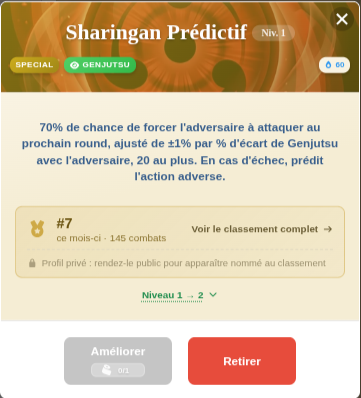

    
    <!-- Évaluation Meta (haut gauche) -->
    

        ⭐⭐ 
    

    
    <!-- Coût en chakra (haut droit) -->
    

        💧 60
    

    <!-- Titre et Niveau -->
    <h1 style="margin: 0 0 15px 0; font-size: 1.8em; text-shadow: 2px 2px 4px rgba(0,0,0,0.8);color: white">
        Sharingan Prédictif
    </h1>

    <!-- Badges du bas (Spécial or & Genjutsu vert) -->
    

        
            Spécial
        
        
            👁️ Genjutsu
        
    

## Description (niv 1)

<em><a href="https://www.shinobi.fr/jutsus/sharingan-predictif">Source : Shinobi.fr</a></em>

  
Effet : <strong>70%</strong> de chance de forcer l'adversaire à attaquer au prochain round, ajusté de ±1% par % d'écart de Genjutsu avec l'adversaire, 20 au plus. En cas d'échec, prédit l'action adverse.

## Evolution par niveau

<table class="js-evo-table">
  <thead>
    <tr>
      <th>Niveau</th>
      <th>Chance de base</th>
    </tr>
  </thead>
  <tbody>
    <tr>
      <td><strong>Niveau 1</strong></td>
      <td>70%</td>
    </tr>
    <tr>
      <td><strong>Niveau 2</strong></td>
      <td>71%</td>
    </tr>
    <tr>
      <td><strong>Niveau 3</strong></td>
      <td>73%</td>
    </tr>
    <tr>
      <td><strong>Niveau 4</strong></td>
      <td>74%</td>
    </tr>
    <tr>
      <td><strong>Niveau 5</strong></td>
      <td>75%</td>
    </tr>
    <tr>
      <td><strong>Niveau 6</strong></td>
      <td>76%</td>
    </tr>
    <tr>
      <td><strong>Niveau 7</strong></td>
      <td>78%</td>
    </tr>
    <tr>
      <td><strong>Niveau 8</strong></td>
      <td>79%</td>
    </tr>
    <tr>
      <td><strong>Niveau 9</strong></td>
      <td>80%</td>
    </tr>
  </tbody>
</table>

## Notes

  
<em>Ajoute ici tes remarques sur les paliers, combos ou interactions du Jutsu.</em>

## Cas d'usage

C'est un jutsu de type **spécial (genjutsu)**. Il sert principalement à forcer l'adversaire à attaquer au round suivant, ce qui est très utile contre les joueurs jouant l'esquive en passif ou lors d'un OVK de type SP[cite: 1].

## Caractéristiques de réussite
En fonction des niveaux, le pourcentage de réussite de base varie de **70% à 80%**[cite: 1]. Avec la différence de Genjutsu, le pourcentage réel varie entre :
* **Sans trophées shuriken :** 85% à 95%[cite: 1]
* **Avec 35 trotro en gen :** 90% à 100% de chance de réussite[cite: 1]

> **Note :** L'**attitude** n'affecte en rien le pourcentage de réussite du JS[cite: 1].

## Mécanique d'échec
En cas d'**échec**, il prédit l'action du round précédent (lorsque le passif le permet)[cite: 1]. 
Dans tous les cas, le JS s'exécute : il n'est **ni esquivable ni ripostable**, comme tous les JS spéciaux[cite: 1].

---

